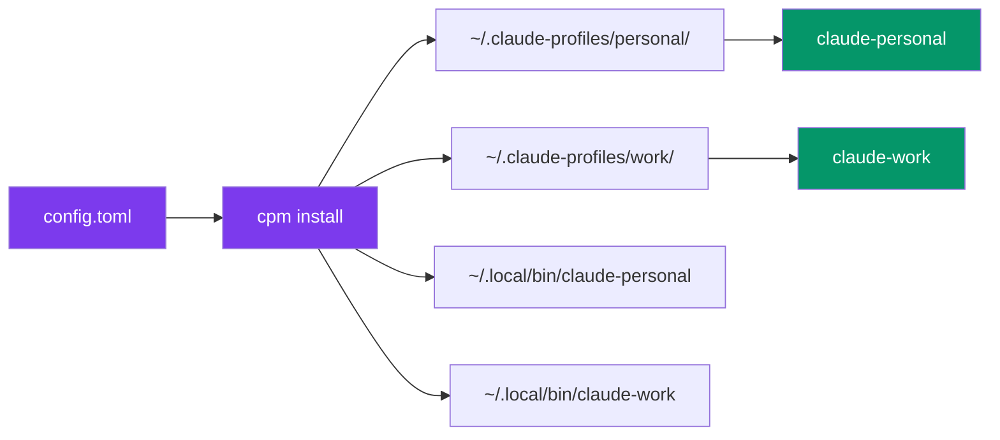
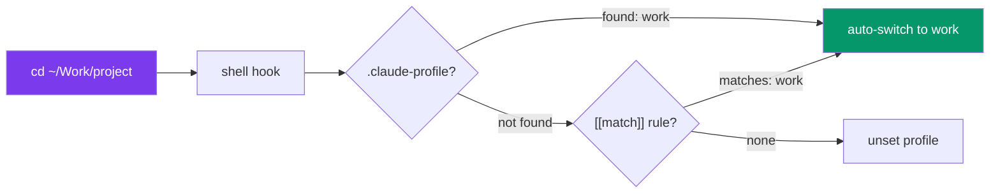

<p align="center">
  
</p>

<h1 align="center">cpm</h1>

<p align="center">
  <strong>Claude Profile Manager</strong> — run multiple Claude Code accounts side-by-side<br/>
  with isolated credentials, shared config, and zero overhead.
</p>

<p align="center">
  <a href="https://github.com/jakubkontra/claude-profile-manager/actions/workflows/test.yml"></a>
  <a href="https://github.com/jakubkontra/claude-profile-manager/releases/latest"></a>
  <a href="https://github.com/jakubkontra/claude-profile-manager/blob/main/LICENSE"></a>
  
</p>

<p align="center">
  <a href="#install">Install</a> ·
  <a href="#quick-start">Quick start</a> ·
  <a href="#commands">Commands</a> ·
  <a href="#configuration">Configuration</a> ·
  <a href="#cloud-sync">Cloud sync</a> ·
  <a href="#shell-integration">Shell integration</a>
</p>

<p align="center">
  
</p>

---

## Why?

You have a personal Claude subscription and a company one. Or a Vertex AI setup. Or three clients. Every time you switch, you re-login, lose context, or mix credentials.

**cpm** gives each account its own `claude-<name>` command. Run them in parallel, auto-switch per project, never re-login.

```bash
claude-personal     # Personal Anthropic subscription
claude-work         # Company team account
claude-vertex       # Company via Google Cloud Vertex AI
```

## Features

- **Isolated credentials** — every profile has its own `CLAUDE_CONFIG_DIR` and its own Keychain entry or `.credentials.json`.
- **Shared setup** — commands, skills, agents, plugins and projects are symlinked from `~/.claude`, so you configure them once.
- **Per-project auto-switch** — drop a `.claude-profile` into a repo, or match repos by git remote or path, and the shell hook picks the right account on `cd`, like `.nvmrc`.
- **Per-profile tuning** — model, extra dirs, env vars, `settings.json` overrides, attribution and MCP servers per profile.
- **Profile in the status line** — `indicator = true` shows the active profile inside Claude Code, so you notice the wrong account before you start.
- **Cloud sync** — keep settings in sync across machines via a private git repo, with secret scanning and conflict-safe pulls.
- **Safe by default** — `--dry-run` previews, local-edit detection on re-sync, backups before overwriting.
- **Scriptable** — `--json` output, `cpm exec`, meaningful exit codes, completions for bash, zsh, fish and PowerShell.
- **Easy to install** — Homebrew, Nix, GitHub Releases or `go install`; self-updates with `cpm upgrade`.

## Install

```bash
brew install jakubkontra/tap/cpm
```

<details>
<summary><strong>GitHub Releases</strong></summary>

Download the latest binary from [Releases](https://github.com/jakubkontra/claude-profile-manager/releases/latest):

```bash
# macOS (Apple Silicon)
curl -L https://github.com/jakubkontra/claude-profile-manager/releases/latest/download/cpm_darwin_arm64 -o ~/.local/bin/cpm
chmod +x ~/.local/bin/cpm
```

</details>

<details>
<summary><strong>Nix / NixOS</strong></summary>

```bash
# Try it
nix run github:jakubkontra/claude-profile-manager -- version

# Install into your profile
nix profile install github:jakubkontra/claude-profile-manager
```

Or add it as a flake input in your NixOS / home-manager config:

```nix
inputs.cpm.url = "github:jakubkontra/claude-profile-manager";
# ...
environment.systemPackages = [ inputs.cpm.packages.${pkgs.system}.default ];
```

`cpm upgrade` can't replace a binary in the Nix store; update the flake input instead.

</details>

<details>
<summary><strong>From source</strong></summary>

```bash
go install github.com/jakubkontra/cpm@latest
```

</details>

**Requirements:** macOS or Linux, Claude Code installed and on `PATH`, and `~/.local/bin` on `PATH` (or configure `bin_dir`).

## Quick start

**1. Create a config** — interactively with `cpm init`, or by hand:

```bash
mkdir -p ~/.claude-profiles
cat > ~/.claude-profiles/config.toml << 'EOF'
source_dir = "~/.claude"
bin_dir = "~/.local/bin"
indicator = true                   # show "cpm: <profile>" in Claude Code's status line

[profiles.personal]
description = "Personal account"

[profiles.work]
description = "Company account"
model = "sonnet"
add_dirs = ["~/Work/company"]
EOF
```

**2. Install profiles and wrapper scripts:**

```bash
cpm install              # add --dry-run to preview first
```

**3. Log in once per profile:**

```bash
claude-personal    # Opens browser for OAuth
claude-work        # Opens browser for OAuth
```

That's it. New profiles skip Claude's onboarding wizard and get your MCP servers right away: `cpm install` seeds `.claude.json` from `~/.claude.json` (theme, onboarding flags — never your account or project state).

**Later**, add or remove profiles without touching the TOML by hand:

```bash
cpm add client -d "Client X" -m opus --add-dir ~/Work/client -e CLAUDE_CODE_USE_VERTEX=1
cpm rename client acme        # rename a profile; it stays logged in
cpm remove acme --purge       # also deletes its directory, credentials and Keychain entry
cpm edit                      # open config.toml in $EDITOR
```

## How it works



Each profile gets an isolated `CLAUDE_CONFIG_DIR` with its own credentials, while sharing commands, skills, plugins, and projects via symlinks. Which directories are shared is configurable (`share` / `isolate`, see [Configuration](#configuration)). Everything else Claude writes into the profile — `plans/`, `history.jsonl`, `file-history/`, `shell-snapshots/`, `tasks/`, `teams/`, `sessions/` — stays per profile.

<details>
<summary><strong>Directory layout</strong></summary>

```
~/.claude-profiles/
├── config.toml
├── personal/
│   ├── settings.json        # Copied (mutable)
│   ├── CLAUDE.md            # Copied (mutable)
│   ├── commands/ -> ~/.claude/commands/   # Symlinked
│   ├── skills/   -> ~/.claude/skills/     # Symlinked
│   ├── plugins/  -> ~/.claude/plugins/    # Symlinked
│   ├── projects/ -> ~/.claude/projects/   # Symlinked
│   ├── .credentials.json    # Per-profile (Linux/CI — on macOS the token lives in the Keychain)
│   ├── .claude.json         # Per-profile (seeded by cpm, maintained by Claude)
│   └── .cpm/baseline/       # What cpm copied, to tell local edits from upstream changes
└── work/
    └── ...
```

</details>

### Credentials

Where the OAuth token ends up depends on the platform:

| Platform | Location |
|----------|----------|
| **macOS** | Keychain, service `Claude Code-credentials-<first 8 hex of sha256(configDir)>`. No `.credentials.json` is written. |
| **Linux / CI** | `<profile>/.credentials.json` |

The default `~/.claude` login uses the bare `Claude Code-credentials` service, so profiles never overwrite each other or your default session.

`cpm doctor` and `cpm credentials` check both and report which one a profile is using. On Linux the file also tells expiry and subscription type; on macOS `cpm doctor --verify` reads the Keychain token to report the same (this may trigger an access prompt).

Switching a profile to a different account always goes through its wrapper, so only that profile's entry is touched:

```bash
claude-work auth status    # which account this profile is on
claude-work auth logout    # clears only the work entry
claude-work auth login     # OAuth in the browser
```

To log in several profiles in one go, for example on a new machine, use `cpm login`. It runs `claude auth login` in each profile, one after another, and prints a summary:

```bash
cpm login --all            # every profile without usable credentials
cpm login work personal    # these profiles, even if already logged in
```

`--all` skips profiles that are already logged in and profiles that authenticate through `ANTHROPIC_API_KEY`, `ANTHROPIC_AUTH_TOKEN`, `CLAUDE_CODE_OAUTH_TOKEN`, Bedrock, Vertex or Foundry.

> [!WARNING]
> A bare `claude auth logout` has no `CLAUDE_CONFIG_DIR` set and logs out your **default** profile instead.

## Per-project profiles

Like `.nvmrc`, but for Claude accounts.



```bash
# Set profile for this project
cd ~/Work/company-project
cpm link work

# Auto-switch on cd (add to .zshrc once)
eval "$(cpm hook)"

# Now every time you cd into this project:
cd ~/Work/company-project
# [cpm] using profile: work

cd ~/personal-project
# [cpm] using profile: personal
```

The `.claude-profile` file is automatically added to `.gitignore`.

### Match by git remote or path

To avoid a `.claude-profile` in every repository, add `[[match]]` rules to `config.toml`:

```toml
[[match]]
remote = "github.com/company/*"   # any remote of the repo, SSH or HTTPS
profile = "work"

[[match]]
path = "~/Work/client/**"
profile = "client"
```

The profile for a directory is chosen in this order:

1. The nearest `.claude-profile`.
2. The first `[[match]]` rule that matches, in file order. A rule with both `remote` and `path` needs both to match.
3. The hook's `--default` profile.
4. Otherwise the profile is unset.

In patterns, `*` matches within one path segment and `**` matches any depth; `~/Work/client/**` also matches `~/Work/client` itself. Remote URLs are compared as `host/owner/repo`, so `git@github.com:company/app.git` and `https://github.com/company/app` are the same. cpm reads the remote from `.git/config` directly, without running git.

`cpm which` shows which rule applied, and `cpm doctor` reports rules whose profile does not exist. The hook reads the rules when the shell starts, so open a new shell after adding the first rule.

## Commands

### Profiles

| Command | Description |
|---------|-------------|
| `cpm init` | Interactive config wizard |
| `cpm install` | Create profile directories and wrapper scripts |
| `cpm add <name> [-d desc] [-m model] [--add-dir dir] [-e K=V] [--no-install]` | Add a profile to `config.toml` and install it |
| `cpm rename <old> <new> [--dry-run]` | Rename a profile: config, `secrets.toml`, `[[match]]` rules, directory, wrapper and Keychain login; reverts on failure |
| `cpm remove <name> [--purge] [--yes]` | Remove a profile; `--purge` deletes its directory, credentials and Keychain entry |
| `cpm clone <src> <dst>` | Clone profile (without credentials) and register it in config |
| `cpm edit` | Open `config.toml` in `$VISUAL` / `$EDITOR` |

`cpm install` flags:

- `--dry-run` — preview local changes with redacted diffs; skip automatic cloud operations
- `--sync` — re-sync mutable files from `~/.claude` (refuses to overwrite local edits)
- `--sync --force` — force overwrite diverged files

### Switching

| Command | Description |
|---------|-------------|
| `cpm use <profile\|auto> [--shell fish] [--quiet]` | Switch shell: `eval "$(cpm use work)"`; `auto` uses `.claude-profile` or `[[match]]`; no argument shows a picker |
| `cpm run <profile> [args]` | One-shot: `cpm run work -p "explain this"` |
| `cpm exec <profile> -- <cmd>` | Run any command with the profile's environment |
| `cpm link <profile>` | Create `.claude-profile` in current dir |
| `cpm unlink` | Remove `.claude-profile` |
| `cpm hook [--shell fish] [--default <profile>]` | Print shell hook for auto-switch via `.claude-profile` and `[[match]]` |
| `cpm direnv <profile>` | Print `.envrc` snippet |

### Inspecting

| Command | Description |
|---------|-------------|
| `cpm list [--json]` | List all profiles with status |
| `cpm which [--json]` | Show active profile (from env, `.claude-profile` or `[[match]]`) |
| `cpm status` | Check sync divergence |
| `cpm doctor [--json] [--verify]` | Diagnose issues; exit code 1 on errors |
| `cpm credentials [--json]` | Show account, expiry and subscription for all profiles |
| `cpm login [profile...] [--all]` | Run `claude auth login` for profiles one at a time, then print a summary |

### Cloud

| Command | Description |
|---------|-------------|
| `cpm cloud init [--remote <url>]` | Initialize cloud sync repo |
| `cpm cloud push [-m "msg"] [--dry-run] [--allow-secrets]` | Push local settings to cloud |
| `cpm cloud pull [--dry-run]` | Pull settings from cloud and re-sync profiles |
| `cpm cloud diff` | Show local changes since the last sync |
| `cpm cloud status` | Show cloud sync status |
| `cpm cloud remote <url>` | Set/update git remote URL |

### Maintenance

| Command | Description |
|---------|-------------|
| `cpm completion <shell>` | Shell completions (bash, zsh, fish, powershell) |
| `cpm version` | Show version + check for updates |
| `cpm upgrade [--prerelease]` | Self-update from GitHub Releases (checksum-verified, never to an older version; Homebrew installs use `brew upgrade`) |

### Previewing an installation

`cpm install --dry-run` displays the local file, MCP, symlink and wrapper changes without writing files or invoking configured cloud auto-pull/auto-push. Text files include redacted unified diffs. Combine it with `--sync` and, when intentionally replacing local edits, `--force`. Preview and installation use the same local plan; a real installation with automatic cloud pull may see newer source data.

## Configuration

Everything lives in `~/.claude-profiles/config.toml`:

```toml
source_dir = "~/.claude"
bin_dir = "~/.local/bin"

[profiles.personal]
description = "Personal Anthropic account"

[profiles.work]
description = "Company team subscription"
model = "sonnet"
add_dirs = ["~/Work/company"]
isolate = ["projects"]             # keep work session history separate from personal
mcp_exclude = ["personal-notion"]  # global MCP server this profile must not see

[profiles.work.attribution]
commit = "Co-Authored-By: Claude <noreply@anthropic.com>"
pr = "Generated with [Claude Code](https://claude.ai/code)"

[profiles.work.settings]           # deep-merged into the profile's settings.json
effortLevel = "high"
permissions.allow = ["Bash(gh *)"]

[profiles.work.mcp_servers.jira]   # profile-specific MCP server
command = "npx"
args = ["-y", "@example/jira-mcp"]

[profiles.vertex]
description = "Company via Vertex AI"
add_dirs = ["~/Work/company"]

[profiles.vertex.env]
CLAUDE_CODE_USE_VERTEX = "1"
ANTHROPIC_VERTEX_PROJECT_ID = "your-project-id"
CLOUD_ML_REGION = "europe-west1"
```

Profile names may contain letters, digits, `-` and `_` only.

With `indicator = true`, `cpm install` sets a `statusLine` in each profile's `settings.json` that prints `cpm: <profile>`. It never replaces a `statusLine` you already have in `~/.claude/settings.json`, in `profiles.<name>.settings` or in the profile itself. Set `indicator` per profile to override the global value; turning it off removes the line cpm added on the next `cpm install`.

<details>
<summary><strong>Config reference</strong></summary>

| Field | Default | Description |
|-------|---------|-------------|
| `version` | `1` | Config format. A config with a higher version needs a newer cpm; new configs get `version = 1` |
| `source_dir` | `~/.claude` | Source for shared config |
| `bin_dir` | `~/.local/bin` | Where wrapper scripts are installed |
| `share` | `["commands", "skills", "agents", "plugins", "projects"]` | Default shared directories |
| `indicator` | `false` | Show the profile name in Claude Code's status line |
| `profiles.<name>.description` | | Human-readable description |
| `profiles.<name>.model` | | Default model (`sonnet`, `opus`) |
| `profiles.<name>.add_dirs` | | Extra dirs passed via `--add-dir` |
| `profiles.<name>.env` | | Environment variables |
| `profiles.<name>.attribution.commit` | | Git commit attribution text |
| `profiles.<name>.attribution.pr` | | PR description attribution text |
| `profiles.<name>.settings` | | Table deep-merged into the profile's `settings.json` (maps merge, other values replace) |
| `profiles.<name>.indicator` | inherits | Overrides the global `indicator` |
| `profiles.<name>.share` | inherits | Directories symlinked from `source_dir` (replaces the global list) |
| `profiles.<name>.isolate` | `[]` | Directories removed from the share list for this profile |
| `profiles.<name>.inherit_mcp` | `true` | Inherit global MCP servers; profile-specific servers always apply |
| `profiles.<name>.mcp_exclude` | `[]` | Global MCP servers this profile does not get |
| `profiles.<name>.mcp_servers.<id>` | | Profile-specific MCP server (same keys as in `~/.claude.json`) |
| `cloud.remote` | | Git remote URL for cloud sync |
| `cloud.auto_push` | `false` | Push after `cpm install` |
| `cloud.auto_pull_on_install` | `false` | Pull before `cpm install` |
| `cloud.exclude` | `[]` | Files/dirs to exclude from sync |
| `cloud.include` | `[]` | Extra files (relative to `source_dir`) to sync |
| `cloud.allow_secrets` | `false` | Skip secret checks before cloud init/push |
| `match[].remote` | | Glob over the repo's remote URLs, as `host/owner/repo` |
| `match[].path` | | Glob over the directory; `~` is the home directory |
| `match[].profile` | | Profile to use when the rule matches |

</details>

<details>
<summary><strong>Shared file handling</strong></summary>

| Type | Files | Behavior |
|------|-------|----------|
| **Copied** | `settings.json`, `settings.local.json`, `CLAUDE.md` | Copied on first install. `--sync` refreshes files you have not edited locally; `--force` overwrites the rest. |
| **Symlinked** | `commands/`, `skills/`, `agents/`, `plugins/`, `projects/` (configurable via `share` / `isolate`) | Shared across profiles |
| **Per-profile** | `.credentials.json`, `.claude.json`, `plans/`, `history.jsonl`, `teams/`, ... | Created by Claude on first use |

</details>

### Choosing profile isolation

`cpm init` and interactive `cpm add` ask whether to share project history and inherit global MCP servers. Both default to **No** for newly created interactive profiles. Existing configurations and noninteractive `add` keep their previous defaults.

For scripts:

```bash
cpm add work --share-projects=false --inherit-mcp=false
```

- `--share-projects=false` stores `isolate = ["projects"]`.
- `--inherit-mcp=false` stores `inherit_mcp = false`. Omitting `inherit_mcp` keeps global inheritance enabled.
- Profile-specific `mcp_servers` remain available regardless of inheritance.
- Enabling history sharing still respects your configured `share` list; it never deletes an existing private history directory to replace it with a symlink.

## Cloud sync

Sync your Claude Code settings (plugins, skills, commands, `settings.json`) across machines via a private git repository.

```bash
# On your first machine — initialize and push
cpm cloud init --remote git@github.com:you/claude-settings.git
cpm cloud push

# On another machine — clone and pull
cpm cloud init --remote git@github.com:you/claude-settings.git
# Files are automatically distributed on clone

# Later — sync changes
cpm cloud push   # from the machine where you changed settings
cpm cloud pull   # on the other machine
```

### What gets synced

| Synced | Not synced |
|--------|------------|
| `settings.json` | Credentials (`.credentials.json`, Keychain) |
| `CLAUDE.md` | `settings.local.json` (machine-specific; opt in with `include`) |
| `commands/`, `agents/`, `skills/` | Sessions, caches, `projects/` |
| `plugins/installed_plugins.json` | Telemetry |
| `plugins/known_marketplaces.json` | |
| `~/.agents/.skill-lock.json` (as `skills/skill-lock.json`) | |
| CPM `config.toml` (new profiles, `[[match]]` rules, `[cloud]` and `indicator` are added; nothing set locally is overwritten) | |

### Tune what gets synced

```toml
[cloud]
remote = "git@github.com:you/claude-settings.git"
exclude = ["CLAUDE.md", "commands/"]     # drop from the sync set
include = ["settings.local.json"]        # add files relative to ~/.claude
auto_push = true                         # push after every `cpm install`
auto_pull_on_install = true              # pull before every `cpm install`
```

### Secrets

Before the initial cloud commit and every push, cpm scans synced JSON and TOML — including profile environment variables and MCP headers — for likely credentials. It refuses secrets and unreadable structured files. `--allow-secrets` is an explicit opt-out on `cloud init` and `cloud push`; it does not make a remote repository private.

Keep credentials in `~/.claude-profiles/secrets.toml` next to `config.toml`:

```toml
[profiles.work.env]
ANTHROPIC_API_KEY = "your-local-key"
```

```bash
chmod 600 ~/.claude-profiles/secrets.toml
cpm install
```

- Local values override the profile's portable `env`.
- Secrets files are never included in cloud sync, even with `cloud.include` or `--allow-secrets`.
- Profiles using local secrets get a wrapper that calls `cpm run` and reads credentials at runtime, so cpm must be on `PATH`. Their direnv snippets also load values at runtime. Profiles without local secrets retain direct wrappers.
- Shell switching exports values into the current process environment, so do not save its output.

> [!WARNING]
> This does not remove secrets already committed by older versions: rotate exposed credentials and clean the Git history separately. Secret detection is heuristic.

### Conflicts and recovery

Cloud sync records the last transferred file hashes locally in `.cpm/cloud-state.json` next to `config.toml`.

- Pull preserves local additions and local edits when the remote file has not changed.
- If both sides changed, or a first pull would overwrite a local file without a baseline, the entire distribution stops before changing live files. Reconcile the named local/cloud files and retry the pull.
- Before overwriting or deleting live files, cpm prints a backup directory under `.cpm/backups/`. Its `restore-paths.json` maps backup files to their original locations — copy the needed files back to recover.

Backups and sync state stay local.

## Shell integration

### Prompt (PS1 / Starship)

Show the active profile in your terminal prompt:

```bash
# .zshrc — simple
PROMPT='$(cpm prompt)> '
```

```toml
# starship.toml — custom command
[custom.claude]
command = "cpm prompt"
when = "test -n \"$CLAUDE_PROFILE\""
format = "[$output]($style) "
style = "purple"
```

### Auto-switch hook

```bash
# .zshrc / .bashrc
eval "$(cpm hook)"
eval "$(cpm hook --default personal)"   # use "personal" outside linked projects

# fish (~/.config/fish/config.fish)
cpm hook --shell fish | source
```

The hook only unsets the variables it set itself (tracked in `CPM_MANAGED_VARS`), so your own `CLAUDE_*` / `ANTHROPIC_*` variables survive a `cd`. In bash it runs from `PROMPT_COMMAND`, so `pushd`/`popd` and scripts are covered too.

### Manual switching

```bash
eval "$(cpm use work)"            # bash / zsh
eval "$(cpm use auto)"            # from the nearest .claude-profile
eval "$(cpm use)"                 # interactive picker
cpm use --shell fish work | source
```

### Completions

```bash
cpm completion zsh > "${fpath[1]}/_cpm"      # zsh
cpm completion bash > /etc/bash_completion.d/cpm
cpm completion fish > ~/.config/fish/completions/cpm.fish
```

### direnv

```bash
# Generate .envrc for a project
cpm direnv work >> ~/Work/company-project/.envrc
direnv allow ~/Work/company-project
```

### Scripts and CI

```bash
cpm exec work -- git commit -m "..."     # any command with the profile's env
cpm list --json | jq -r '.[] | select(.current) .name'
cpm doctor --json && echo healthy       # exit code 1 on errors
```

## Upgrading

```bash
cpm upgrade         # self-update
brew upgrade cpm    # or via Homebrew
```

Release candidates (`v1.0.0-rc.1`) are published as GitHub prereleases. `cpm upgrade` and Homebrew skip them. To try one, run `cpm upgrade --prerelease`. A release candidate keeps updating to newer release candidates and then to the final release, and never back to an older version.

## License

[MIT](LICENSE)
